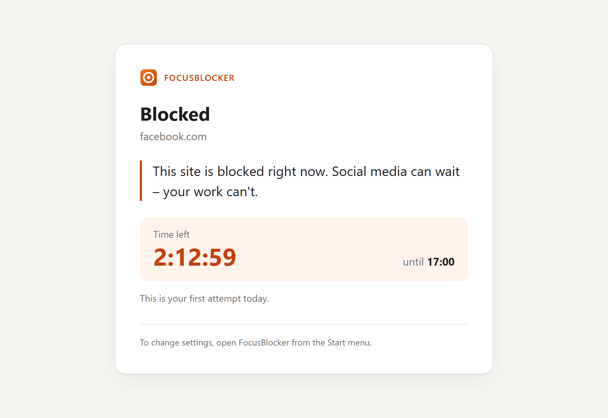
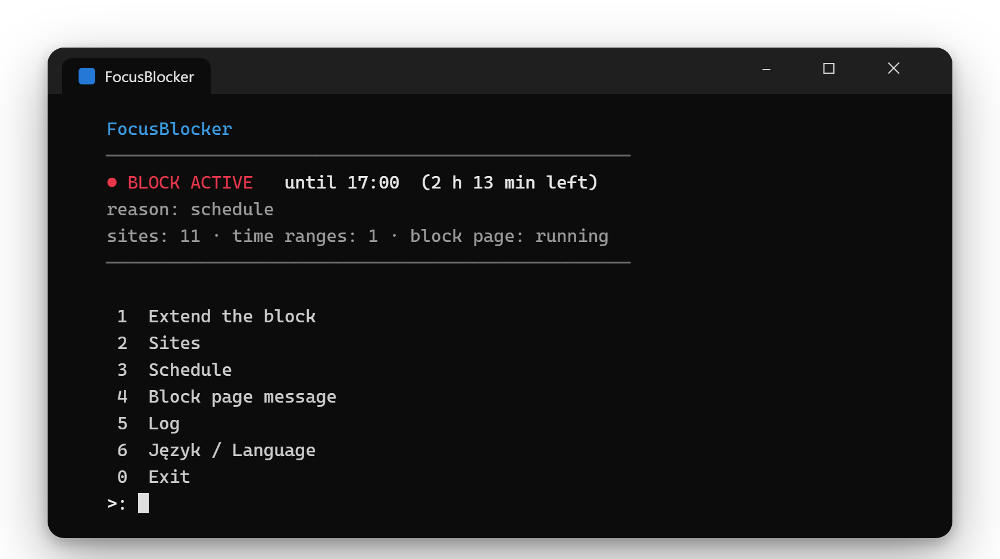
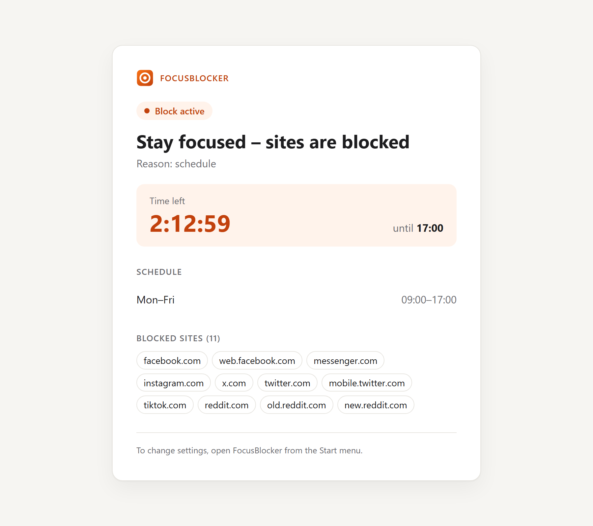
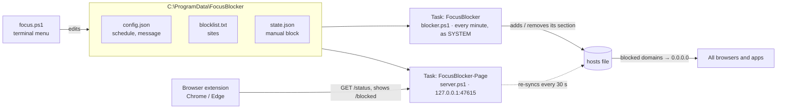

#  FocusBlocker

**A website blocker for Windows that you can't switch off once it starts.**
Blocks distracting sites (Facebook, Instagram, X, TikTok, Reddit…) during your working hours –
in every browser and app – using only what already ships with Windows: PowerShell, the `hosts`
file and Task Scheduler.

[](https://github.com/sebastian-kostecki/focus-blocker/actions/workflows/ci.yml)
[](#installation)
[](#how-it-works)
[](extension/)
[](#how-it-works)
[](LICENSE)

🇵🇱 [Polska wersja README](README.pl.md)

<p align="center">
  <picture>
    <source media="(prefers-color-scheme: dark)" srcset="docs/images/blocked-dark.png">
    
  </picture>
</p>

## Features

- **No way back** – a running block can't be stopped or shortened: not from the menu, not by
  reinstalling, not by uninstalling. It can only be extended.
- **Weekly schedule** – e.g. Mon–Fri 09:00–17:00; ranges can cross midnight (22:00–02:00).
- **Focus now** – start a block on demand: 25 min, 50 min, 1.5 h, 2 h, until end of day or any
  custom time (up to 7 days).
- **Works everywhere** – blocking happens in the `hosts` file, so it covers every browser and app.
- **Self-healing** – remove the entries by hand and they're back within a minute.
- **Friendly block page** – instead of a connection error, the Chrome/Edge extension shows your
  own message, a live countdown and how many times you've tried today. Light and dark mode.
- **Status at a glance** – click the extension's toolbar icon to see the current block, the
  schedule and the site list.
- **English and Polish** – the terminal menu, block page and extension follow your Windows
  language and can be switched in the menu (option 6) at any time.
- **Zero dependencies** – nothing to download or install besides the scripts themselves.

## Installation

1. Download `FocusBlocker-<version>.zip` from [Releases](../../releases/latest) and extract it,
   e.g. to `Documents` – you'll get a `FocusBlocker` folder.
2. Open **PowerShell as administrator** and run:

   ```powershell
   cd "$HOME\Documents\FocusBlocker"
   powershell -ExecutionPolicy Bypass -File .\install.ps1
   ```

3. Load the browser extension:
   - open `chrome://extensions` (Edge: `edge://extensions`),
   - turn on **Developer mode**,
   - click **Load unpacked** and select `C:\ProgramData\FocusBlocker\extension`.

That's it – a **FocusBlocker** shortcut appears in the Start menu.

## Usage

Launch **FocusBlocker** from the Start menu (Windows will ask for administrator rights).

<p align="center">
  
</p>

| Option | What it does | While a block is active |
|---|---|---|
| 1 | Start a block now: 25 min, 50 min, 1.5 h, 2 h, until end of day or a custom time (`90` or `16:30`) | extend only |
| 2 | Add or remove sites (several at once, comma-separated) | add only |
| 3 | Add or remove schedule ranges, e.g. `mon-fri` 09:00–12:00 | add only |
| 4 | Message shown on the block page | yes |
| 5 | Recent log entries | yes |
| 6 | Interface language (English / Polski) | yes |

Click the **FocusBlocker icon** in the browser toolbar to open the status page:

<p align="center">
  <picture>
    <source media="(prefers-color-scheme: dark)" srcset="docs/images/status-dark.png">
    
  </picture>
</p>

Days can be typed in English or Polish, whichever interface language you use: `mon-fri`,
`mon,wed,fri`, `sat sun`, `daily` (or `pon-pt`, `sob nd`, `codziennie`).

There is also a non-interactive script used by Task Scheduler:

```powershell
.\blocker.ps1 -Mode Status          # show current state
.\blocker.ps1 -Mode On -Minutes 60  # start a 60-minute block
.\blocker.ps1 -Mode Auto            # sync the hosts file with the schedule
```

## How it works



1. **The `hosts` file** – Windows checks it before asking DNS. An entry like
   `0.0.0.0 facebook.com` makes the site unreachable in every browser and app at once.
   FocusBlocker only touches its own marked section and leaves the rest of the file alone.
2. **Task “FocusBlocker”** runs every minute (and at startup) as SYSTEM. It checks whether a block
   should be active (schedule or manual block) and adds or removes the section accordingly.
3. **Task “FocusBlocker-Page”** runs a tiny local web server (`server.ps1`), reachable only from
   this machine. It serves the block page and the block state for the extension, and re-checks
   the `hosts` file every 30 s as a second line of defence.
4. **The browser extension** (Chrome/Edge, Manifest V3) redirects blocked sites to the block page
   and also swaps out tabs that were already open when the block started.

### Why an extension?

Almost every site uses HTTPS. The `hosts` file alone can't serve a custom page in place of
facebook.com – the browser expects Facebook's certificate and would show a security error. The
only alternative would be installing a custom root CA, which weakens the security of the whole
machine. The extension does the same thing safely. **Blocking works without the extension** too;
you just see a plain connection error instead of the message.

## Files

Everything is installed to `C:\ProgramData\FocusBlocker` (writable by administrators only).

| File | Purpose |
|---|---|
| `focus.ps1` | terminal menu |
| `blocker.ps1` | non-interactive version for Task Scheduler |
| `server.ps1` | local block page server |
| `lib.ps1` | shared functions |
| `i18n.ps1` | interface texts (English and Polish) |
| `blocklist.txt` | blocked sites (one domain per line, `#` = comment) |
| `config.json` | schedule, language and block page message |
| `state.json` | end of the manual block |
| `blocker.log` | log |
| `hosts.backup` | copy of `hosts` from before the first change |
| `extension\` | browser extension |

## Updating and uninstalling

- **Update:** run `install.ps1` from the new version. Your site list and schedule are kept.
- **Uninstall** (as administrator):

  ```powershell
  powershell -ExecutionPolicy Bypass -File "C:\ProgramData\FocusBlocker\uninstall.ps1"
  ```

  Remove the extension manually in `chrome://extensions`.

Both refuse to run while a block is active.

## Limitations

- You are the administrator of your computer, so a determined person can always delete the
  scheduled tasks by hand. FocusBlocker isn't a prison – it makes getting around the block take
  enough effort that going back to work is easier.
- It doesn't work through a VPN or a proxy with its own DNS.
- The `hosts` file has no wildcards. `www.` and `m.` are added to root domains automatically;
  other subdomains need their own line (the extension catches all subdomains anyway).
- The extension works in Chrome and Edge. In Firefox the block works, but without the message page.

## Development

Tests use [Pester](https://pester.dev) 5+ and run in a temporary folder – your real `hosts` file
is never touched. Every push is checked on GitHub Actions with PSScriptAnalyzer and Pester under
Windows PowerShell 5.1.

```powershell
Install-Module Pester, PSScriptAnalyzer -Scope CurrentUser -SkipPublisherCheck
Invoke-Pester .\tests
Invoke-ScriptAnalyzer -Path . -Recurse -Settings .\PSScriptAnalyzerSettings.psd1
```

## License

[MIT](LICENSE)
