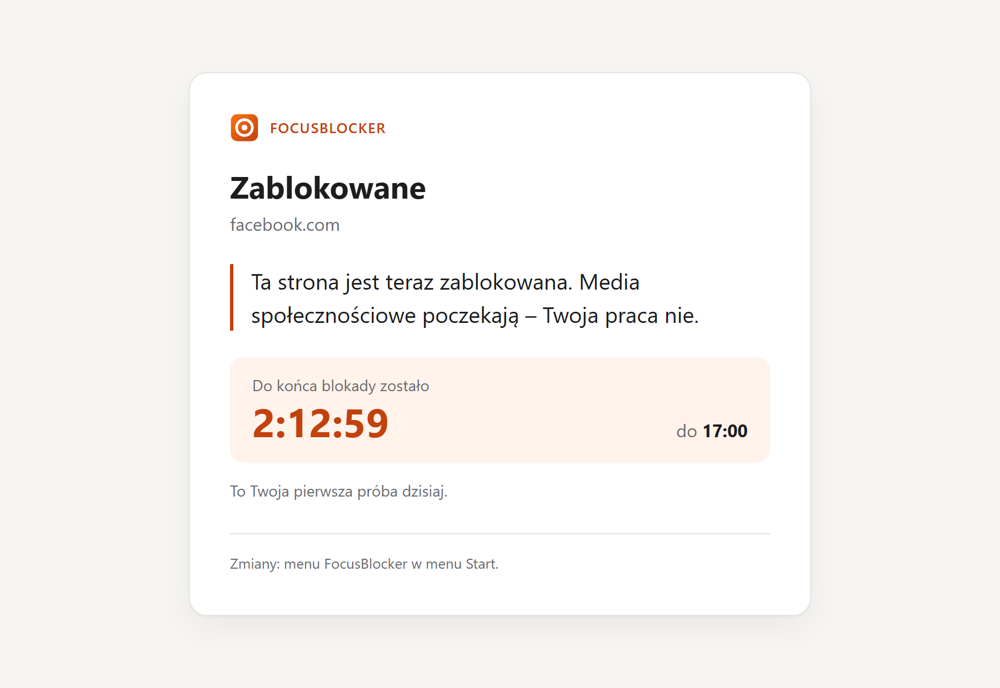
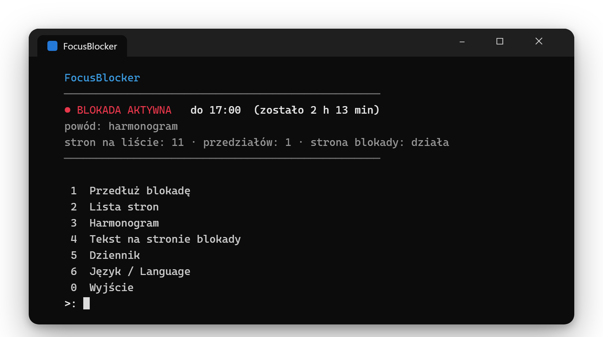
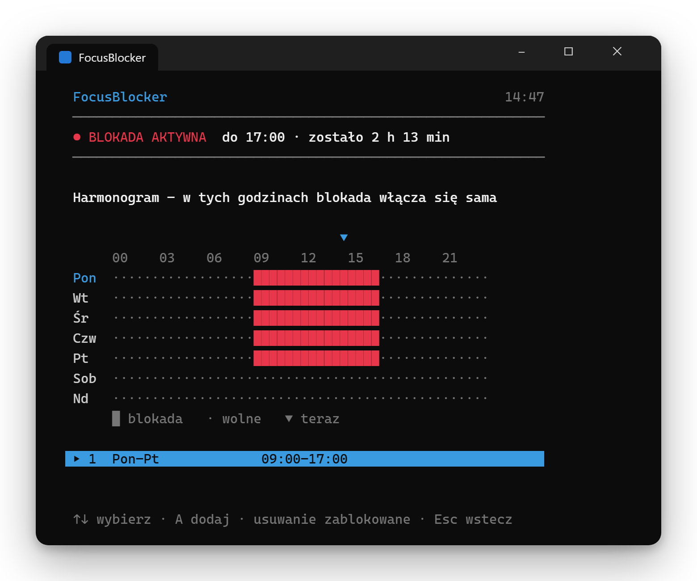
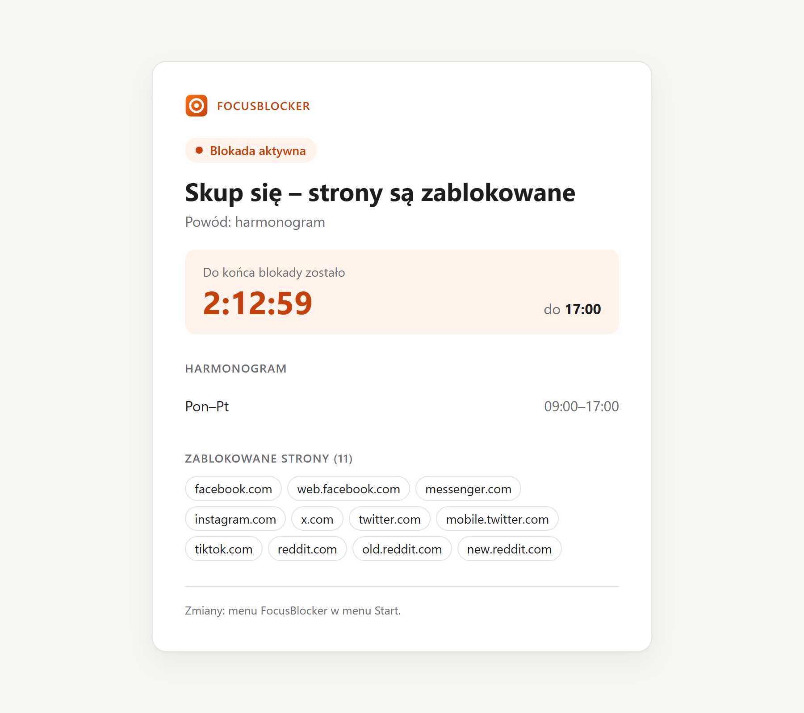
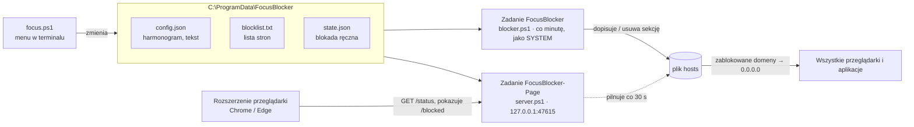

#  FocusBlocker

**Blokada stron dla Windows, której nie da się wyłączyć, gdy już trwa.**
Blokuje rozpraszające strony (Facebook, Instagram, X, TikTok, Reddit…) w godzinach pracy –
we wszystkich przeglądarkach i aplikacjach naraz. Korzysta tylko z tego, co ma Windows:
PowerShella, pliku `hosts` i Harmonogramu zadań.

[](https://github.com/sebastian-kostecki/focus-blocker/actions/workflows/ci.yml)
[](#instalacja)
[](#jak-to-działa)
[](extension/)
[](#jak-to-działa)
[](LICENSE)

🇬🇧 [English README](README.md)

<p align="center">
  <picture>
    <source media="(prefers-color-scheme: dark)" srcset="docs/images/blocked-dark-pl.png">
    
  </picture>
</p>

## Funkcje

- **Bez odwrotu** – trwającej blokady nie da się wyłączyć ani skrócić: ani z menu, ani przez
  ponowną instalację, ani przez odinstalowanie. Można ją tylko przedłużyć.
- **Harmonogram tygodniowy** – np. pon–pt 09:00–17:00; przedział może przechodzić przez północ.
- **Blokada od razu** – 25 min, 50 min, 1,5 h, 2 h, do końca dnia albo własny czas (do 7 dni).
- **Działa wszędzie** – blokada siedzi w pliku `hosts`, więc obejmuje każdą przeglądarkę i aplikację.
- **Sama się naprawia** – ręcznie usunięte wpisy wracają w ciągu minuty.
- **Strona z komunikatem** – zamiast błędu połączenia rozszerzenie pokazuje Twój tekst,
  odliczanie do końca blokady i licznik dzisiejszych prób. Tryb jasny i ciemny.
- **Stan pod ręką** – kliknięcie ikony rozszerzenia na pasku przeglądarki pokazuje bieżącą
  blokadę, harmonogram i listę stron.
- **Polski i angielski** – menu w terminalu, strona blokady i rozszerzenie podążają za językiem
  Windows i można je w każdej chwili przełączyć w menu (klawisz `J`).
- **Pulpit w terminalu na żywo** – nawigacja jednym klawiszem, tykające odliczanie z paskiem
  postępu, dzisiejszy licznik prób i siatka tygodnia dla harmonogramu.
- **Zero zależności** – nic nie trzeba doinstalowywać.

## Instalacja

**Instalator:** pobierz `FocusBlocker-Setup-<wersja>.exe` z [Releases](../../releases/latest),
uruchom i zaakceptuj monit o uprawnienia administratora. Nie jest podpisany, więc SmartScreen może
ostrzec („Więcej informacji” → „Uruchom mimo to”). Nie zainstaluje, nie zaktualizuje ani nie
odinstaluje programu, gdy trwa blokada. Potem przejdź do kroku 3 poniżej (rozszerzenie zawsze
ładuje się ręcznie).

**Albo ręcznie z ZIP-a:**

1. Pobierz `FocusBlocker-<wersja>.zip` z [Releases](../../releases/latest) i rozpakuj,
   np. do `Dokumenty` – powstanie folder `FocusBlocker`.
2. Otwórz **PowerShell jako administrator** (Start → wpisz „PowerShell” → „Uruchom jako administrator”):

   ```powershell
   cd "$HOME\Documents\FocusBlocker"
   powershell -ExecutionPolicy Bypass -File .\install.ps1
   ```

3. Zainstaluj rozszerzenie:
   - otwórz `chrome://extensions` (w Edge: `edge://extensions`),
   - włącz **Tryb dewelopera**,
   - kliknij **Załaduj rozpakowane** i wskaż folder `C:\ProgramData\FocusBlocker\extension`.

Gotowe. W menu Start pojawi się skrót **FocusBlocker**.

## Obsługa – menu w terminalu

Uruchom skrót **FocusBlocker** z menu Start (Windows zapyta o uprawnienia administratora).

<p align="center">
  
</p>

Pulpit obsługuje się pojedynczymi klawiszami: strzałki <kbd>↑</kbd> <kbd>↓</kbd> i <kbd>Enter</kbd>
albo od razu litera skrótu. <kbd>Esc</kbd> cofa. Odliczanie tyka na żywo, a pasek postępu pokazuje,
ile blokady już minęło. Włączenie blokady zawsze wymaga wpisania `TAK`, więc nie zrobisz tego
przypadkiem.

| Klawisz | Co robi | W trakcie blokady |
|---|---|---|
| `1` `2` `3` `4` | Szybki start: 25 min, 50 min, 1,5 h, 2 h | przedłuża blokadę o ten czas |
| `B` | Blokada od razu: opcje jak wyżej, do końca dnia albo własny czas (np. `90` lub `16:30`) | tylko przedłużenie |
| `S` | Lista stron: dodawanie (kilka po przecinku) i usuwanie | tylko dodawanie |
| `H` | Harmonogram: siatka tygodnia ze znacznikiem „teraz”; dodawanie i usuwanie przedziałów, np. `pon-pt` 09:00–12:00 | tylko dodawanie |
| `K` | Tekst wyświetlany na stronie blokady | tak |
| `D` | Ostatnie wpisy w dzienniku | tak |
| `J` | Język interfejsu (Polski / English) | tak |

<p align="center">
  
</p>

Jeśli czcionka terminala nie ma znaków ramek i bloków, ustaw `FOCUSBLOCKER_ASCII=1`, a pulpit użyje
zwykłych znaków ASCII.

Kliknij **ikonę FocusBlockera** na pasku przeglądarki, żeby zobaczyć stronę stanu:

<p align="center">
  <picture>
    <source media="(prefers-color-scheme: dark)" srcset="docs/images/status-dark-pl.png">
    
  </picture>
</p>

Dni w harmonogramie wpisuje się po polsku lub angielsku, niezależnie od wybranego języka
interfejsu: `pon-pt`, `pon,sr,pt`, `sob nd`, `codziennie` (albo `mon-fri`, `daily`).

Jest też wersja nieinteraktywna, z której korzysta Harmonogram zadań:

```powershell
.\blocker.ps1 -Mode Status          # pokaż stan
.\blocker.ps1 -Mode On -Minutes 60  # włącz blokadę na 60 minut
.\blocker.ps1 -Mode Auto            # dopasuj plik hosts do harmonogramu
```

## Jak to działa



1. **Plik `hosts`** – Windows najpierw sprawdza ten plik, zanim zapyta serwer DNS. Wpis
   `0.0.0.0 facebook.com` sprawia, że komputer „myśli”, że Facebook jest pod adresem, z którym
   nie da się połączyć. Działa to we wszystkich przeglądarkach i aplikacjach naraz.
2. **Zadanie „FocusBlocker”** uruchamia się co minutę (i przy starcie Windows) jako konto SYSTEM.
   Sprawdza, czy teraz trwa blokada (harmonogram albo blokada ręczna), i dopisuje lub usuwa
   sekcję FocusBlockera w pliku `hosts`. Resztę pliku zostawia w spokoju.
3. **Zadanie „FocusBlocker-Page”** uruchamia mały lokalny serwer WWW (`server.ps1`) dostępny
   tylko z tego komputera. Pokazuje stronę z komunikatem i podaje stan blokady rozszerzeniu.
   Co 30 s dodatkowo pilnuje pliku `hosts`.
4. **Rozszerzenie przeglądarki** (Chrome/Edge, Manifest V3) zamiast błędu połączenia pokazuje
   stronę z Twoim tekstem. Zamienia też karty, które były otwarte w chwili rozpoczęcia blokady.

### Dlaczego potrzebne jest rozszerzenie?

Prawie wszystkie serwisy działają po HTTPS. Sam plik `hosts` nie może podsunąć przeglądarce
własnej strony zamiast facebook.com, bo przeglądarka zażąda certyfikatu Facebooka – skończy
się błędem bezpieczeństwa. Jedyną alternatywą byłoby zainstalowanie własnego certyfikatu
głównego (CA) w systemie, co osłabia bezpieczeństwo całego komputera. Rozszerzenie robi to
samo bezpiecznie. **Blokada działa także bez rozszerzenia** – wtedy zobaczysz zwykły błąd
połączenia zamiast komunikatu.

## Pliki (`C:\ProgramData\FocusBlocker`)

| Plik | Zawartość |
|---|---|
| `focus.ps1` | menu w terminalu |
| `blocker.ps1` | wersja dla Harmonogramu zadań |
| `server.ps1` | lokalna strona blokady |
| `lib.ps1` | wspólne funkcje |
| `i18n.ps1` | teksty interfejsu (polski i angielski) |
| `blocklist.txt` | lista stron (jedna domena na linię, `#` = komentarz) |
| `config.json` | harmonogram, język i tekst komunikatu |
| `state.json` | koniec blokady ręcznej |
| `blocker.log` | dziennik |
| `hosts.backup` | kopia pliku `hosts` sprzed pierwszej zmiany |
| `extension\` | rozszerzenie przeglądarki |

Zapisywać w tym folderze może tylko administrator.

## Aktualizacja i odinstalowanie

- **Aktualizacja:** uruchom `install.ps1` z nowej wersji. Lista stron i harmonogram zostaną zachowane.
- **Odinstalowanie** (jako administrator):

  ```powershell
  powershell -ExecutionPolicy Bypass -File "C:\ProgramData\FocusBlocker\uninstall.ps1"
  ```

  Rozszerzenie usuń ręcznie w `chrome://extensions`.

Obie operacje odmówią działania, dopóki trwa blokada.

## Uczciwie o ograniczeniach

- Jesteś administratorem tego komputera, więc zdeterminowana osoba zawsze może ręcznie usunąć
  zadania z Harmonogramu zadań. FocusBlocker nie jest więzieniem – ma sprawić, że ominięcie
  blokady wymaga tyle wysiłku, że łatwiej wrócić do pracy.
- Blokada nie działa przez VPN ani proxy z własnym DNS.
- Plik `hosts` nie obsługuje symboli wieloznacznych. Do domen głównych automatycznie dochodzą
  `www.` i `m.`; inne subdomeny dopisz osobno (rozszerzenie i tak łapie wszystkie subdomeny).
- Rozszerzenie działa w Chrome i Edge. W Firefoksie blokada działa, ale bez strony z komunikatem.

## Rozwój

Testy korzystają z [Pestera](https://pester.dev) 5+ i działają w folderze tymczasowym – prawdziwy
plik `hosts` nie jest ruszany. Każdy push sprawdzają GitHub Actions: PSScriptAnalyzer i Pester
w Windows PowerShell 5.1.

```powershell
Install-Module Pester, PSScriptAnalyzer -Scope CurrentUser -SkipPublisherCheck
Invoke-Pester .\tests
Invoke-ScriptAnalyzer -Path . -Recurse -Settings .\PSScriptAnalyzerSettings.psd1
```

## Licencja

[MIT](LICENSE)
